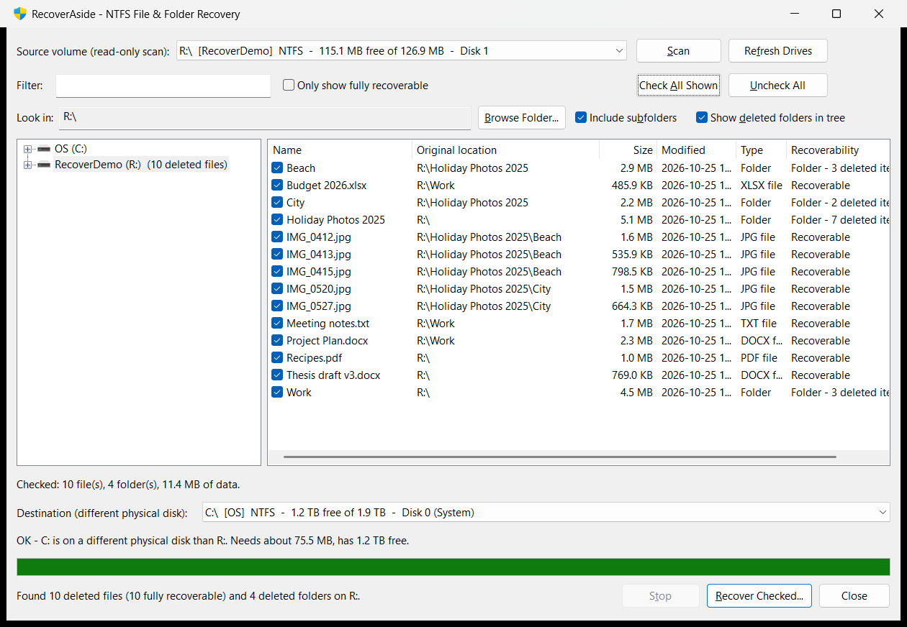

# RecoverAside

A Windows (MFC) utility that recovers deleted files and folders from NTFS drives **without risking further
damage to the disk being recovered**. The source disk is only ever read, and recovered data is only written
to a different physical disk.

## Screenshots



## Features

- **Explorer-style browsing.** The folder tree lists every NTFS drive and its existing folders as you expand
  them, so no scan is needed to browse. Selecting a folder scans its drive automatically (read-only).
- **Deleted file and folder discovery.** Reads the NTFS Master File Table (MFT) directly and finds records
  marked *not in use*, including whole deleted folders, and rebuilds each item's original location.
- **Browse deleted folders.** After a scan, deleted folders appear in the tree (marked `[deleted]`) next to
  existing folders, with a count of deleted files under each. Double-click a folder in the list to open it.
- **Recover by folder.** Select any folder, existing or deleted, to list the deleted items in it
  (*Include subfolders* makes this recursive). Ticking a deleted folder includes everything deleted inside it.
- **Recoverability check.** Each deleted file's clusters are checked against the volume's cluster bitmap.
  The list shows **Recoverable**, **Partially overwritten (N%)**, **Overwritten** or **Not supported**.
- **Damaged-file warning.** Before recovery, any ticked file that was overwritten is listed in a warning
  window. You choose which to recover or skip; fully overwritten files are skipped by default.
- **Safe destination only.** See [Safety rules](#safety-rules).
- **USB prompt.** If no safe destination is attached, the program says how much free space is needed and asks
  you to attach a USB or external drive. New drives are detected automatically.
- **Faithful output.** Original folder structure and timestamps are kept, and a `RecoveryLog.txt` records the
  result for every file.

## Safety rules

| Rule | How it is enforced |
| --- | --- |
| Never write to the source | The source volume is opened `GENERIC_READ` only. The recovery thread also refuses to write if the destination resolves to the source volume. |
| Never write to the source *disk* | The destination must be on a different physical disk (`IOCTL_VOLUME_GET_VOLUME_DISK_EXTENTS`), so another partition on the same disk is refused. |
| Enough space | Free space must cover the selected data plus one cluster of slack per item, 1%, and a 64 MB reserve. |
| File-system limits | FAT32 destinations are refused when a selected file is larger than 4 GB. |
| Writable, local | Read-only, network, optical and RAM drives are not offered as destinations. |

When several drives qualify, USB/removable drives are preferred, then the emptiest disk.

## Requirements

- Windows 10 or 11.
- **Administrator rights**: raw volume access needs elevation, and the program asks for it at start-up.
- To build: Visual Studio 2022 or later with the **Desktop development with C++** workload and the
  **C++ MFC for latest build tools** component.

## Building

Open `RecoverAside.sln` in Visual Studio, or run the build script (it finds Visual Studio by itself):

```powershell
.\build.ps1                                     # Release build, x64 and x86
.\build.ps1 -Platform x64 -Package -Version 1.0.0   # also zip the exe + README into .\dist
```

The output is `bin\x64\Release\RecoverAside.exe` (`bin\Win32\Release\` for x86). MFC is linked statically,
so the exe runs on its own. The project uses the default toolset of whichever Visual Studio builds it
(v143 for VS 2022, v145 for VS 2026).

## Continuous integration

[`.github/workflows/build.yml`](.github/workflows/build.yml) runs on GitHub Actions:

| Trigger | What happens |
| --- | --- |
| Pull request to `main`, or a manual run | Builds x64 and x86 with `build.ps1`, with compiler warnings treated as errors, and uploads the zips as build artifacts. |
| Push to `main` | Same build as version `1.0.<run number>`, then publishes a GitHub release `v1.0.<run number>` (the workflow creates the tag) with `RecoverAside-1.0.<run number>-x64.zip` and `-x86.zip`. The Deployments installer takes the x64 zip. |
| Push of a tag such as `v1.2.0` | Same build, then publishes a GitHub release `v1.2.0` with `RecoverAside-1.2.0-x64.zip` and `RecoverAside-1.2.0-x86.zip`. |

Each zip holds `RecoverAside.exe` and this README. To change the major or minor version of the automatic releases,
edit `1.0.` in the workflow's *Work out version* step. To cut a release with a version of your own:

```bash
git tag v1.0.0
```

```bash
git push origin v1.0.0
```

## Usage

1. Run `RecoverAside.exe` (accept the Administrator prompt).
2. In the tree, select the drive or folder where the files were deleted. **Browse Folder...** jumps straight
   to an existing folder. The drive is scanned automatically. The Windows system drive asks first, because
   Windows keeps writing to it.
3. Browse the results: select folders in the tree, or double-click folders in the list. Use **Filter** and
   *Only show fully recoverable* to narrow the list.
4. Tick the files or folders to recover (**Check All Shown** ticks everything listed).
5. Pick a **Destination** on a different physical disk. Unsafe drives are marked `NOT USABLE` with the reason.
6. Click **Recover Checked...**. Review the damaged-file warning if it appears, then confirm.

Recovered files are written to:

```
<destination>:\RecoverAside_<yyyyMMdd_HHmmss>\<letter>_drive\<original path>\<file>
```

with `RecoveryLog.txt` in the `RecoverAside_...` folder. Each line is `OK`, `WARN` (recovered but possibly
damaged), `FAIL` or `SKIP`.

## Project layout

| File | Purpose |
| --- | --- |
| `RecoverAside/NtfsVolume.*` | Read-only NTFS reader: MFT scan, fix-ups, run lists, bitmap check, file extraction. |
| `RecoverAside/DriveInfo.*` | Volume enumeration, physical-disk mapping, USB detection. |
| `RecoverAside/RecoverAsideDlg.*` | Main window: folder tree, results list, destination checks, scan and recovery threads. |
| `RecoverAside/DamagedFilesDlg.*` | Warning window for overwritten files. |
| `RecoverAside/RecoverAside.rc`, `resource.h` | Dialog layouts and version info. |

## Limitations

- Only NTFS drives can be scanned (FAT32/exFAT can still be used as destinations).
- NTFS-compressed and EFS-encrypted files are listed but not recovered.
- Very fragmented files whose cluster map was stored in an MFT extension record may be recovered only partly.
- If a deleted folder's MFT record has been reused, its files can no longer be placed and appear under
  `$Orphaned [location unknown]`. They can still be recovered from there.
- The cluster bitmap is read once per scan, so a file reported as recoverable can still be overwritten
  before you recover it, especially on the system drive. For the best results, attach the disk to another PC
  and recover from there.
- Browsing existing folders reads folder names through Windows. This never writes file data, so it cannot
  overwrite deleted files.
